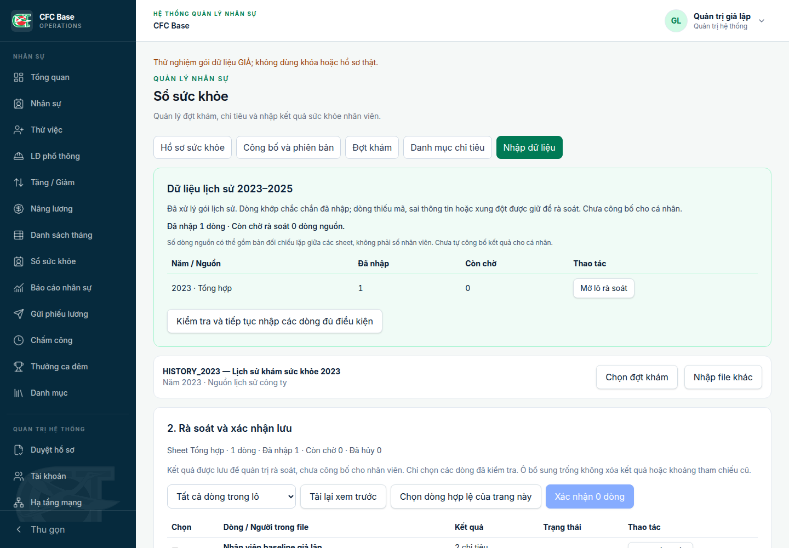
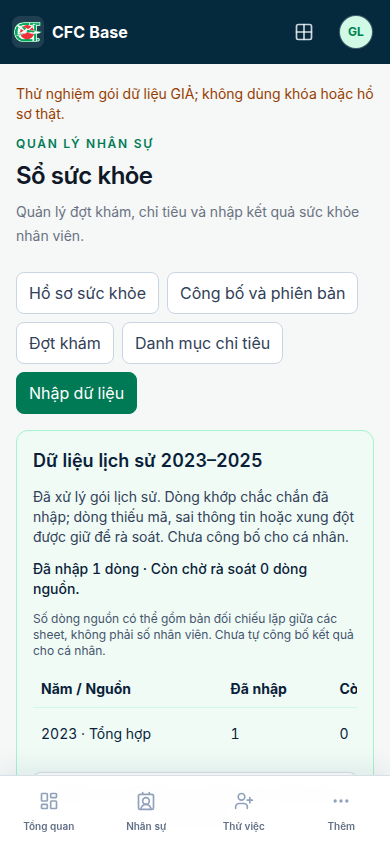

# Tự nhập dữ liệu khám lịch sử khi deploy

Cập nhật23/11/2026. Thay thao tác ánh xạ lại từng cột của ba workbook lịch sử bằng một gói dữ liệu mã hóa đi kèm release. Chỉ ADMIN/MANAGER xem trạng thái, cài khóa và tiếp tục rà soát. Phần phát triển20/11 chỉ test dev; đến23/11, người dùng đã cung cấp log deploy thành công và ảnh nhập lịch sử83/936 trên server. Đợt tổng hợp tài liệu này không thao tác production.

## Đã kích hoạt rồi thì chọn gì?

Ảnh ngày23/11 xác nhận **83 dòng đã nhập,936 dòng nguồn còn chờ**. Không cần upload khóa lại hoặc tạo thêm đợt để nhập lại cùng bộ nguồn.

1. **Hồ sơ sức khỏe:** xem kết quả đã nhập nội bộ. Không cần công bố mới thấy ở màn quản trị.
2. **2025 · Gián tiếp → Mở lô rà soát:** xử lý2 dòng còn chờ.
3. **2024 · Tổng hợp → Mở lô rà soát:** nguồn chính256 dòng chờ; ghép đúng nhân sự và xem lỗi trước xác nhận.
4. **2023 · Tổng hợp → Mở lô rà soát:** nguồn chính208 dòng chờ, cách xử lý tương tự.
5. Sheet4/Sheet5/Gián tiếp/Trực tiếp/KẾT QUẢ SK còn lại để đối chiếu, bổ sung ô thiếu và giải quyết chênh lệch sau; không xác nhận tất cả sheet chỉ vì tên giống nhau.

Các số trên là ảnh chụp trạng thái theo thời điểm, không phải số cố định trong code. Còn chờ không đồng nghĩa mất dữ liệu; chúng đã nằm staging. Công bố cho cá nhân là bước riêng sau rà soát.

## Cách dùng lần đầu

1. Push nhánh `feat/fedora-deploy`, tạo PR vào `main`; đợi CI và merge. Fedora nhận bản mới theo timer đang có. Không đưa file Excel, bản Markdown chứa kết quả hoặc khóa vào Git public.
2. Sau khi release lên, đăng nhập ADMIN/MANAGER → **Sổ sức khỏe → Nhập dữ liệu** → **Dữ liệu lịch sử 2023–2025**. Chọn **File khóa dữ liệu lịch sử**, rồi **Kích hoạt và tự nhập lịch sử**.
3. Khóa đã tạo trên máy dev ở `/home/kali/.local/share/cfcbase/health/history-import.key`. Trong hộp chọn file có thể dùng Ctrl+L rồi nhập đường dẫn. Chọn file này từ máy đang mở trình duyệt; không dán nội dung vào chat, Git hoặc ticket. Đây là khóa dữ liệu dùng một lần cho máy chủ, khác mã tra cứu cá nhân.
4. Chờ trạng thái hoàn tất. Các dòng khớp chắc chắn được nhập; bấm **Mở lô rà soát** để giải quyết dòng còn chờ. Không phải chọn 35 cột nữa.

Sau lần cài khóa đầu tiên, những lần khởi động/deploy tiếp theo tự kiểm tra gói. Gói đã xử lý không bị nhập lại. Nếu HR được bổ sung mã/ngày sinh đúng, nút **Kiểm tra và tiếp tục nhập các dòng đủ điều kiện** xử lý tiếp mà không tạo bản trùng. Không phải mỗi release đều tải khóa lại.

## Dữ liệu và quy tắc

Gói hiện tại chứa 1.019 dòng nguồn từ 8 sheet của ba workbook 2023–2025. Đây là số dòng nguồn, có lặp giữa sheet/năm, không phải 1.019 nhân viên hoặc lượt khám đã duyệt. Sheet công việc không trở thành kết quả khám. Không có dữ liệu khám 2026 và không mang nhân sự giả/DB dev lên server.

- Nguồn chính là `Tổng hợp` và workbook kết quả 2025. Sheet phụ/bổ sung đưa vào lô rà soát; không tự ghi đè.
- Tự xác nhận chỉ khi mã nhân viên, tên và thông tin sinh nguồn khớp đủ với nhân sự hiện có. Không ghép chỉ theo tên; thiếu ngày sinh nhân sự hoặc thông tin không chắc chắn giữ chờ.
- Năm 2023/2024 theo SID đã được người dùng xác nhận. Không suy ngày khám từ SID.
- SID đã nhập từ nguồn khác, kết quả xung đột hoặc lô có namespace/ánh xạ thủ công khác được giữ hoặc chặn để kiểm tra; không đổi nguồn/ánh xạ ngầm.
- Dùng lại staging, preview token và transaction ghi hiện có. Ghi nhận audit; thử lại hoặc restart sau nhập dở không tạo lượt trùng.
- Không tự công bố kết quả, cấp quyền tra cứu hoặc bật cổng cá nhân. Công bố và xác minh liên kết vẫn là nghiệp vụ riêng.

## Bảo quản khóa và vận hành

Gói trong JAR dùng AES-256-GCM, nonce ngẫu nhiên và nén gzip; khóa 32 byte nằm ngoài repository/JAR. Backend lưu khóa mặc định tại `${user.home}/.local/share/cfcbase/health/history-import.key`, quyền file0600, thư mục0700. Trên Fedora, `user.home` là home của tài khoản chạy backend. Không cần thêm `.env`.

`history-import-receipt.json` cùng thư mục chỉ lưu hash gói và ID lô, không chứa kết quả. Cần sao lưu khóa riêng bằng kênh riêng tư; backup SQL không chứa khóa. Khi chuyển server cần khôi phục khóa và DB. Nếu receipt còn nhưng DB phục hồi thiếu lô, hệ thống tự chuẩn bị lại và kiểm tra chống trùng. Không có chức năng tự xoay khóa; gói mới phải mã hóa bằng khóa đang dùng.

Nhập chạy nền sau ApplicationReady trên một worker. Không đọc lại workbook Excel trên Fedora. Lỗi nhập hiển thị trạng thái ERROR và giữ các lô đã ghi để thử lại; không làm backend ngừng phục vụ. Deploy đạt health-check không đồng nghĩa mọi dòng lịch sử đã được xác minh; cần kiểm tra trạng thái nhập trên web.

Khi gói lịch sử thay đổi, wrapper CI yêu cầu backup DB. Build script còn so gói trong JAR staging với JAR đang phục vụ trước kích hoạt, bảo vệ cả lần đầu rollout bằng wrapper cũ. Backup lỗi chặn kích hoạt. Không thêm migration và không thay cơ chế duyệt migration SQL/Java hiện có; database không tự rollback.

## Tạo gói cập nhật

`HealthHistoryBundleTool` trong test-source nhận ba đối số: thư mục ba workbook gốc, đường dẫn bundle đầu ra, đường dẫn khóa private ngoài repo. Dùng lại khóa đã cấp; công cụ tự kiểm tra giải mã/round-trip trước ghi. Không chạy công cụ này trong startup production. Excel nguồn nặng cần JVM heap1536MiB khi đóng gói trên dev; riêng giải mã gói đã được kiểm chứng với JVM heap256MiB (không phải mức RAM cam kết của toàn ứng dụng).

Không sửa trực tiếp bundle bằng tay, không commit dump DB, khóa, dữ liệu nguồn hoặc log chứa kết quả. Chỉ commit ciphertext và code. Khi dữ liệu mới có xung đột vẫn phải rà soát theo nguồn, không dùng deploy để tự thay kết quả đã nhập.

## Kiểm tra dev

H2 và MySQL riêng kiểm tra: thiếu/sai khóa; kích hoạt qua HTTP; ApplicationReady tự chạy; restart/retry; thiếu thông tin sinh; xung đột; SID nguồn khác; lô thủ công; phục hồi DB thiếu lô; quyền ADMIN/MANAGER và chặn HR_STAFF/anonymous. Runner MySQL dựng DB QA loopback tạm, backup/restore và so checksum, không nối Fedora.

MCP đã chạy 9 nhóm HTTP thật cho luồng này, gồm mở lô và mobile, cùng 24 nhóm hồi quy import/ánh xạ. Ảnh bên dưới chỉ chứa dữ liệu giả. Không dùng ảnh hoặc fixture làm bằng chứng đã nhập dữ liệu thật lên production.

Kết quả kiểm tra cuối 20/11/2026: full backend460 test,0 failure/error,55 skipped (gồm50 MySQL opt-in được chạy riêng đạt toàn bộ); restore79 bảng có count/checksum khớp. Deploy Python52 test và frontend Node30 test đạt. Frontend build đạt, lint0 lỗi/10 cảnh báo cũ; chunk HrHealth90,94kB so với khoảng87,1kB trước thay đổi. Graph AST local đã cập nhật, không tái trích xuất semantic tài liệu/ảnh. Các process preview do tác vụ này mở đã dừng sau nghiệm thu.
