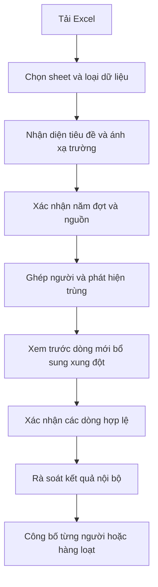

# Kế hoạch Sổ sức khỏe nhân viên — CFCBase

Ngày lập: **10/11/2026**. Trạng thái: **Phase 1–7 có bản triển khai dev; Phase 3 đã nạp thử lịch sử vào H2 riêng, còn hồ sơ chờ quản trị xác minh. Phase 4 có hồ sơ/timeline/so sánh nội bộ; Phase 5 có báo cáo và xuất Excel/PDF; Phase 6 có rà soát/công bố/thu hồi theo phiên bản. Phase 7 có cổng tra cứu dev theo mã riêng đã duyệt; chưa deploy/mở dữ liệu thật**. Bàn giao: [Phase 1](EMPLOYEE_HEALTH_PHASE1_DEV.md), [Phase 2](EMPLOYEE_HEALTH_PHASE2_DEV.md), [Phase 3](EMPLOYEE_HEALTH_PHASE3_DEV.md), [Phase 4](EMPLOYEE_HEALTH_PHASE4_DEV.md), [Phase 5](EMPLOYEE_HEALTH_PHASE5_DEV.md), [Phase 6](EMPLOYEE_HEALTH_PHASE6_DEV.md), [Phase 7](EMPLOYEE_HEALTH_PHASE7_DEV.md).

Nguồn: sáu file Excel/Markdown người dùng cung cấp, các xác nhận trong cuộc trao đổi và source CFCBase. Chi tiết khảo sát: [EMPLOYEE_HEALTH_DATA_ANALYSIS.md](EMPLOYEE_HEALTH_DATA_ANALYSIS.md). Tài liệu này không chứa hồ sơ hay kết quả sức khỏe của người thật.

## 1. Mục tiêu và phạm vi đã xác nhận

Xây dựng Sổ sức khỏe gắn với nhân sự, giúp phòng Tổ chức – Hành chính – Nhân sự quản lý dữ liệu khám định kỳ và giúp từng người xem lịch sử sức khỏe qua các năm.

| Nội dung | Đã chốt |
|---|---|
| Nhóm nhân sự | Gián tiếp = văn phòng/hành chính; trực tiếp = công nhân |
| Dữ liệu ban đầu | Bộ nguồn công ty đến năm 2025, có kết quả lịch sử 2023–2024; chưa khám năm 2026 |
| File tương lai | Bệnh viện xuất mẫu có thể thay đổi; từng người có thể khám thêm chỉ tiêu và nhận kết quả bổ sung |
| Quản trị | Chỉ ADMIN và MANAGER được xem chi tiết, nhập, sửa, xuất và công bố |
| HR_STAFF | Không truy cập module hoặc dữ liệu sức khỏe qua API, báo cáo, tìm kiếm, tài liệu hay liên kết hồ sơ nhân sự |
| Cá nhân | Có trang tra cứu riêng, không cần tài khoản CFCBase, không phụ thuộc Telegram |
| Định danh tra cứu | Người dùng chọn CCCD và mã nhân viên; cơ chế xác minh được phân tích ở mục 4, không coi định danh là bí mật |
| Công bố | ADMIN/MANAGER công bố kết quả trước khi cá nhân được xem; có thao tác hàng loạt |
| So sánh/xuất | Một người, nhóm được lọc hoặc tất cả người trong phạm vi quản trị; hỗ trợ nhiều năm/đợt |

Đợt khám, hồ sơ nhân sự, nhóm làm việc và gói xét nghiệm là các khái niệm riêng. Công nhân vẫn có thể khám thêm; một người có thể đổi nhóm/phòng ban hoặc khám nhiều lần trong năm.

Chưa đưa vào phạm vi bản đầu: quản lý bệnh viện, kê đơn/chỉ định, thanh toán viện phí, chẩn đoán AI, kết nối thiết bị xét nghiệm, tích hợp trực tiếp Bộ Công an/VNeID/cổng sức khỏe quốc gia. Chỉ tham khảo cách tổ chức hồ sơ và trải nghiệm từ ảnh người dùng đã gửi, không khẳng định có kết nối với các hệ thống đó.

## 2. Trải nghiệm sử dụng dự kiến

### 2.1 Phía quản trị

Menu **Nhân sự → Sổ sức khỏe**, các khu vực:

| Khu vực | Người dùng làm được gì |
|---|---|
| Tổng quan | Chọn năm/đợt; xem số người, lượt khám, kết quả đã công bố, hồ sơ cần rà soát và phân bố phân loại |
| Đợt khám | Tạo đợt, chọn bệnh viện, phạm vi dự kiến, theo dõi kết quả và khóa quản trị |
| Hồ sơ sức khỏe | Tìm theo mã/tên, nhóm, đơn vị; mở một người xem toàn bộ lịch sử |
| Nhập dữ liệu | Nhận Excel, ánh xạ cột, ghép người, xử lý dữ liệu bổ sung và lỗi |
| So sánh & báo cáo | Chọn kỳ, chỉ tiêu, người hoặc tập thể; xem trước và xuất |
| Rà soát | Chưa ghép, trùng, xung đột, giá trị không hợp lệ, thông tin thiếu |
| Công bố | Chọn từng hồ sơ hoặc công bố hàng loạt theo điều kiện; thu hồi có lý do |

Hồ sơ nhân sự có liên kết sang Sổ sức khỏe chỉ khi ADMIN/MANAGER truy cập. Không thêm dữ liệu sức khỏe vào DTO nhân sự chung mà HR_STAFF đang đọc được.

### 2.2 Phía cá nhân

Trang độc lập `/health-lookup`, giao diện ưu tiên điện thoại, phù hợp màn hình khoảng 360 px trở lên. Không có sidebar quản trị.

Sau bước xác minh, hiển thị:

1. **Tổng quan của tôi:** họ tên, định danh được che bớt, lần khám gần nhất, phân loại theo kết luận nguồn và nội dung cần chú ý đã được công bố.
2. **Lịch sử khám:** timeline theo năm → ngày/đợt; thấy rõ không có dữ liệu, có dữ liệu chưa đầy đủ và kết quả đã công bố.
3. **Chi tiết lần khám:** thể lực, khám chuyên khoa, xét nghiệm, hình ảnh/kết luận dạng văn bản, hướng dẫn và tệp kết quả cá nhân nếu có.
4. **So sánh qua các năm:** chọn 2 hoặc nhiều kỳ; bảng/biểu đồ từng chỉ tiêu, phân loại, kết luận của cơ sở khám.
5. **Tải kết quả:** phiếu cá nhân và bảng so sánh của chính mình; không có chức năng xuất danh sách công ty.

Tham khảo ảnh đã gửi ở cách chia Thông tin – Lịch sử – Chỉ số và mở kết quả theo lần khám; dùng thiết kế CFCBase, không sao chép giao diện bệnh viện.

Ví dụ hiển thị: năm 2023 có kết quả, 2024 có kết quả bổ sung, 2025 có kết quả, 2026 hiện **Chưa có dữ liệu khám**. Không suy ra nhân viên chưa đi khám hoặc sức khỏe bình thường từ việc hệ thống chưa nhận file.

## 3. Dữ liệu lịch sử và các nguyên tắc import

### 3.1 Baseline đã khảo sát

| Nguồn | Dữ liệu quan trọng | Cách dự kiến xử lý |
|---|---|---|
| Workbook so sánh 2023–2024 | Tổng hợp có 464 SID; gợi ý 208 lượt năm 2023, 256 lượt năm 2024; các sheet con đều có SID nằm trong Tổng hợp | Đã được người dùng chọn Tổng hợp làm nguồn ban đầu; sheet con chỉ bổ sung ô thiếu sau đối chiếu, khác tên/kết quả chờ xác nhận |
| Sheet5 trong workbook trên | 124 lượt; 32 SID khác cách ghi tên so với Tổng hợp | Giữ dấu vết nguồn và yêu cầu xác nhận liên kết/tên; không nhân đôi lượt |
| Workbook bổ sung 2024 | 23 dòng cần bổ sung, 13 dòng kết quả/136 cột; 13 SID đã nằm trong Tổng hợp; Mã NV của các dòng kết quả trống | Bổ sung vào lượt cũ sau đối chiếu, tách bảng việc cần làm khỏi bảng kết quả |
| Workbook 2025 | 85 người gián tiếp, 47 trường, 85 mã nhân viên riêng | Liên kết theo mã nhân viên, kiểm tra tên và năm sinh; chưa kết luận có dữ liệu công nhân 2025 |

Các con số trên là kiểm kê file, không phải số người duy nhất toàn công ty hoặc số đã xác nhận nhập. Không cộng dòng giữa các sheet. Người dùng đã xác nhận năm 2023/2024 theo SID cho bộ lịch sử này; chưa xác nhận ngày khám. File mới vẫn phải xác minh quy ước riêng, không coi SID là ngày chắc chắn.

### 3.2 Luồng import

- Nhận `.xlsx` ở bản đầu; file mã hóa/macro/PDF scan/OCR là ngoài phạm vi parser ban đầu và được báo rõ.
- Chọn sheet hiển thị/ẩn minh bạch. Không tự nhập sheet ẩn, bảng tổng hợp tỷ lệ hoặc ghi chú như hồ sơ khám.
- Nhận tiêu đề hàng 1/2/3/4 hoặc nhiều hàng; ánh xạ tên/alias, xem trước cột chưa nhận diện. Tên trường Code không được đoán là mã nhân viên.
- Lưu profile ánh xạ theo nguồn/bệnh viện/phiên bản cấu trúc. Khi cấu trúc đổi, kiểm tra lại, không áp dụng mù profile cũ.
- Một chỉ tiêu có danh tính chuẩn, tên gốc, phương pháp và đơn vị. Không gộp trùng vì chỉ giống chữ sau khi bỏ hậu tố máy.
- Cột mới được giữ ở vùng chờ ánh xạ; không bỏ âm thầm. Cho người có quyền tạo/ghép danh mục sau preview.
- Đề xuất bản đầu nhận một người trên một dòng. Mẫu nhiều dòng mỗi người hoặc mỗi xét nghiệm một dòng cần adapter riêng, hiển thị không hỗ trợ khi chưa có adapter; không hứa nhận mọi file tự động.
- Ghép mã chính xác trước; tên/năm sinh chỉ hỗ trợ gợi ý. Mã đã đổi, người nghỉ/tái tuyển, thiếu mã hoặc trùng tên phải có hàng đợi xác nhận.
- Không tự tạo nhân viên HR hoặc sửa CCCD/đơn vị trong HR từ kết quả bệnh viện. Giữ liên kết employee ID nội bộ ổn định.
- File trùng kiểm tra hash; lượt trùng dựa trên nguồn/cơ sở + SID, liên kết người và đợt, không chỉ năm. Không có SID phải dùng khóa được duyệt, không gộp hai lần tái khám cùng năm.
- Ô file bổ sung trống không xóa giá trị cũ. Ô mới có giá trị nhưng khác bản đã có: hiển thị trước/sau, người quản trị chọn và ghi lý do.
- Chỉ tiêu không có kết quả hiển thị **Không có dữ liệu**, không tự gán 0 hoặc Bình thường. Phân biệt không thuộc gói, đang chờ, thiếu dữ liệu và không áp dụng khi có nguồn xác nhận; chưa biết lý do thì giữ chưa rõ.
- Bảng 23 trường hợp bổ sung là thông tin công việc, không tự biến thành 23 lượt khám. Ghi chú không có kết quả vì tuyển sau kỳ khám phải được giữ riêng.
- Xem trước tổng dòng hợp lệ/lỗi/chờ ghép/trùng; cho lưu tập hợp dòng hợp lệ đã chọn, lưu trạng thái từng dòng để lần sau không nhập lại phần đã xác nhận.

### 3.3 Các tình huống bắt buộc hỗ trợ

1. Một người có thêm xét nghiệm ngoài gói; chỉ người đó có các chỉ tiêu mới.
2. Bệnh viện gửi kết quả từng phần hoặc đổi thứ tự/tên cột.
3. Cùng người, cùng SID có file đính chính hoặc bổ sung muộn.
4. Cùng người khám hai lần cùng năm hoặc khám ở hai cơ sở.
5. Tên khác dấu/chính tả; trùng họ tên; chỉ có năm sinh.
6. Nhân viên đã nghỉ vẫn có lịch sử; người không có trong HR còn ở vùng chờ ghép.
7. Một file chứa nhiều năm, có sheet ẩn, cột không có tiêu đề hoặc nhóm cột lặp.
8. Phân loại II., Ii hoặc ô nhập nhầm lời hướng dẫn; giữ nguyên bản gốc khi chuẩn hóa.
9. Giá trị `<`, `>`, âm tính/dương tính hoặc huyết áp 120/80 không bị ép thành số đơn.
10. Bệnh viện thay đơn vị/phương pháp hoặc khoảng tham chiếu theo lần khám.
11. Dữ liệu Excel có _x000D_, ô ngày và số điện thoại mất 0 đầu.
12. Định dạng Excel kéo dài hàng chục nghìn cột nhưng vùng dữ liệu thực nhỏ; có giới hạn dung lượng/ô/thời gian và thông báo lỗi.

## 4. Tra cứu cá nhân: điều đã chốt và điểm còn cần duyệt

### 4.1 Không cần tài khoản hệ thống, vẫn phải xác minh quyền xem

Ngày 12/11/2026, người dùng duyệt **hai cách tra cứu: CCCD + mã nhân viên hoặc chỉ nhập mã tra cứu riêng**. ADMIN/MANAGER bật cách hai trường theo từng người; mặc định grant chỉ cho mã riêng. Không dùng Telegram/SMS. CCCD và mã nhân viên là định danh; bí mật riêng là mã ngẫu nhiên chỉ hiện lúc cấp, DB giữ hash, có hạn dùng, cấp lại/thu hồi chặn mã và phiên cũ.

ADMIN/MANAGER xác minh người nhận trước khi giao mã. Người thiếu CCCD hợp lệ không được tự mở hồ sơ; cần xử lý thông tin nhân sự theo quyền hiện có. Cổng thật vẫn cần nghiệm thu Phase 8 (HTTPS/proxy/rate-limit/retention/MySQL/backup), không tự bật sau khi hoàn tất code dev.

### 4.2 Yêu cầu phiên tra cứu

- Gửi định danh trong POST body qua HTTPS; không đặt CCCD, mã bí mật hoặc kết quả lên URL, analytics hay log.
- Sau xác minh, cấp phiên chỉ có quyền xem một health subject đã liên kết; không nhận employee ID từ client để chọn hồ sơ khác.
- Các API nội dung và tải file kiểm tra phiên + đối tượng + công bố ở mọi request. Không dùng quyền truy cập được kiểm tra chỉ ở bước mở trang.
- Phiên riêng với JWT quản trị, có hết hạn/thoát/thu hồi; nếu dùng cookie thì HttpOnly/Secure/SameSite phù hợp và bảo vệ CSRF cho thao tác ghi.
- Lỗi tra cứu dùng thông báo chung, không tiết lộ CCCD tồn tại, họ tên hoặc trạng thái hồ sơ. Giới hạn thử theo nguồn và định danh được băm phù hợp, tránh khóa dài gây chặn cả mạng công ty.
- Không lưu kết quả/CCCD/session token vào localStorage, URL state hay cache bền vững của trình duyệt. Không hiển thị lại dữ liệu người trước sau khi thoát trên máy dùng chung.
- HTTP `Cache-Control: no-store` cho kết quả/file; PWA không lưu API hoặc phiếu sức khỏe. Query cache chỉ trong RAM, xóa khi thoát/đổi người/thu hồi, không dùng dữ liệu cũ sau lỗi xác minh.
- Nhân viên thiếu CCCD, mã trùng/tái sử dụng hoặc chưa liên kết không được tự mở hồ sơ: đưa về quy trình hỗ trợ xác minh.

## 5. Xem tình trạng và so sánh qua năm

Mục tiêu là người xem hiểu **dữ liệu sức khỏe đã được ghi nhận và thay đổi ra sao**, có ngữ cảnh nguồn, không biến ứng dụng thành công cụ tự chẩn đoán.

| Thành phần | Hành vi |
|---|---|
| Phân loại sức khỏe | Lịch sử I–V nếu nguồn có; hiển thị tên/phân loại từ cơ sở khám, thiếu thì báo chưa có |
| Chỉ số số học | Đường/bảng kết quả theo ngày, giá trị gốc, đơn vị/phương pháp/khoảng tham chiếu từng lần |
| Khám chuyên khoa/hình ảnh | Kết luận theo từng lần; ảnh/PDF chỉ có nếu thực sự được cung cấp |
| Kết luận và hướng dẫn | Giữ tác giả/nguồn; hiển thị đầy đủ lời hướng dẫn của cơ sở khám |
| Nội dung cần chú ý | Dựa vào cờ nguồn hoặc giá trị so với khoảng tham chiếu đủ dữ kiện, gắn nhãn nguồn; không suy luận bệnh hoặc mức nguy hiểm |
| Theo dõi/tái khám | Ghi chú hành chính và tình trạng xử lý do người phụ trách nhập, tách khỏi kết luận bác sĩ |

- Chênh lệch số chỉ tính cho cùng chỉ tiêu, đơn vị và bối cảnh phương pháp có thể so sánh. Nếu chưa rõ thì vẫn đặt cạnh nhau, ghi **Cần đối chiếu đơn vị/phương pháp**, không vẽ như cùng một chuỗi đồng nhất.
- Tăng không mặc định là xấu, giảm không mặc định là tốt. Không tự tạo điểm sức khỏe 0–100 hoặc dự đoán bệnh.
- Chưa đủ khoảng tham chiếu thì không gắn màu Bình thường. Giữ số gốc với dấu `<`/`>` và không dùng giá trị giới hạn đó để tính phần trăm tăng/giảm như số đo chính xác.
- Huyết áp có thể trình bày hai thành phần khi tách được chắc chắn; vẫn giữ chuỗi gốc. Chỉ có năm sinh thì không suy ra ngày sinh/ngày khám.
- Chế độ nhiều lượt trong năm mặc định hiển thị tất cả theo ngày. Nếu người dùng chọn mỗi năm một lượt, đề xuất lượt khám định kỳ đã xác nhận gần nhất theo ngày khám; lượt bổ sung nối vào lượt gốc và tái khám vẫn tách. Quy tắc này cần duyệt, không chọn theo ngày import.
- Bảng tập thể tách số người/lượt; báo tỷ lệ có mẫu số rõ, phân biệt người có dữ liệu ở cả hai kỳ với chỉ có một kỳ. Không suy luận công ty khỏe hơn từ thay đổi thành phần người tham gia.
- Nhóm/phòng ban lịch sử ưu tiên snapshot có nguồn tại đợt khám. Nếu chỉ có thông tin HR hiện tại thì ghi rõ là nhóm/đơn vị hiện tại, không giả làm thông tin lịch sử.

## 6. Công bố, sửa và thu hồi

Tách ba vòng đời:

| Đối tượng | Trạng thái đề xuất |
|---|---|
| Import | Đang kiểm tra → Chờ xác nhận → Đã nhập một phần/Đã nhập → Hủy phần chưa nhập |
| Lượt khám nội bộ | Chờ rà soát → Đã xác nhận; đợt có thể Mở/Đã khóa để bảo vệ chỉnh sửa |
| Phiên bản công bố theo người/lượt | Chưa công bố → Đã công bố → Đã thu hồi; lần sửa tạo phiên bản mới |

- Chỉ công bố kết quả đã liên kết chắc chắn với nhân viên, đã xác nhận năm/đợt và không còn lỗi chặn. Kết quả thiếu chỉ tiêu có thể công bố nếu được xác nhận là bản chưa đầy đủ và không thiếu trường định danh bắt buộc.
- Công bố hàng loạt: chọn người/tất cả theo bộ lọc, có xem trước phạm vi và số được phép/bị chặn; xác nhận bằng tập ID + version được server kiểm tra, không tự lấy filter đã đổi sau preview.
- Kết quả hàng loạt trả số thành công/bỏ qua/xung đột có lý do; chọn 20 dòng của trang hiện tại khác với chọn tất cả theo bộ lọc.
- Người quản trị xem **đang biên tập** và **đã công bố** tách biệt. Sửa/import bổ sung không tự thay kết quả người dân đang xem; cần công bố phiên bản mới.
- Công bố theo người trong một transaction ngắn, bảo đảm bộ kết quả người đó nhất quán. Toàn đợt lớn chia lô; retry không nhân đôi phiên bản hoặc audit.
- Thu hồi cần lý do, có từng người/hàng loạt; request nội dung/tệp sau thu hồi bị chặn ngay. File người dùng đã tải về trước đó không thể thu hồi khỏi thiết bị của họ.
- Khóa đợt không đồng nghĩa công bố. Mở khóa không tự thu hồi hoặc tái công bố. Không xóa lịch sử nguồn/sửa để làm mất dấu kết quả đã phát hành.

## 7. Báo cáo và xuất file

| Đầu ra | Đối tượng | Nội dung |
|---|---|---|
| Phiếu cá nhân PDF | Quản trị và chủ hồ sơ | Một lần khám, kết luận, chỉ tiêu, nguồn và thời điểm công bố; là bản tổng hợp hệ thống, không giả chữ ký/phiếu bệnh viện |
| So sánh cá nhân Excel | Quản trị và chủ hồ sơ | Chọn năm/đợt, các cột thời điểm và hàng chỉ tiêu, giá trị gốc/đơn vị/ghi chú |
| So sánh tập thể Excel | ADMIN/MANAGER | Danh sách theo bộ lọc hoặc toàn bộ; các sheet Tổng quan, So sánh, Chi tiết chỉ tiêu, Thiếu dữ liệu theo nhu cầu |
| Thống kê đợt/năm | ADMIN/MANAGER | Số người/lượt, phân loại, giới tính, gián tiếp/trực tiếp, đơn vị có nguồn và mức đầy đủ dữ liệu |
| Danh sách cần xử lý | ADMIN/MANAGER | Thiếu thông tin/chưa ghép/trùng/xung đột/chờ tái khám theo ghi nhận |
| Nhật ký nhập/công bố/xuất | ADMIN/MANAGER | Người thao tác, thời điểm, phạm vi, kết quả, phiên bản; không sao chép kết quả khám vào log chung |

Mặc định tập thể xuất một workbook theo dạng bảng có thể lọc, không tạo hàng trăm sheet theo người. ZIP nhiều PDF, mẫu Excel giữ nguyên bố cục cũ và PDF so sánh nhiều năm là mở rộng sau khi người dùng duyệt mẫu. Preview dùng cùng bộ lọc/quy tắc với export; đánh dấu bản nội bộ chưa công bố. Tệp export cố định phạm vi/version tại lúc bắt đầu, không trộn dữ liệu sửa giữa chừng.

Tệp cá nhân chỉ chứa người được phép, không trả workbook gốc nhiều người. Bảo vệ tên file/Content-Disposition và Excel formula injection; server kiểm tra quyền tải, có thời hạn cho file tạm và không cho đường dẫn public trực tiếp. Không dùng viewer ONLYOFFICE hoặc buộc chạy dịch vụ Office.

## 8. Thiết kế kỹ thuật dự kiến và giới hạn tác động

Đây là hướng triển khai để review, không phải schema/API đã tồn tại.

### 8.1 Mô hình dữ liệu

- **Health subject:** ID ổn định, liên kết employee ID đã xác minh; tách dữ liệu chưa ghép khỏi dữ liệu được phép công bố. Không tạo tài khoản user cho công nhân.
- **Campaign/visit:** đợt khám, cơ sở, ngày/độ chính xác ngày, loại định kỳ/bổ sung/tái khám, SID gốc có namespace nguồn, snapshot nhóm/đơn vị nếu có căn cứ.
- **Indicator/alias:** mã chỉ tiêu chuẩn, tên/nhóm, kiểu dữ liệu; tên gốc/phương pháp/đơn vị đi cùng từng kết quả, không chỉ đặt mặc định toàn hệ thống.
- **Observation:** kết quả gốc, giá trị cấu trúc nếu parse chắc chắn, đơn vị, khoảng tham chiếu/cờ nguồn và provenance file/sheet/dòng/cột. Hỗ trợ numeric/text/coded/range/comparator/components.
- **Import/mapping/issues:** phiên bản cấu trúc, hash, preview có phân trang, trạng thái từng dòng/ô và các quyết định đối chiếu; phần thô có retention được chốt khi triển khai.
- **Publication/version:** bộ kết quả theo người/lượt đã công bố bất biến, snapshot quyền hiển thị, audit sửa/công bố/thu hồi.
- **Health document/access:** tệp riêng từng người/lượt có kiểm tra quyền; phiên tra cứu và audit tối thiểu; thông tin mã bí mật chỉ thêm nếu được duyệt.

Tham khảo cách tách báo cáo khỏi từng kết quả đo của [HL7 FHIR DiagnosticReport](https://www.hl7.org/fhir/diagnosticreport.html) và [Observation](https://www.hl7.org/fhir/observation.html). Chỉ mượn mô hình khái niệm; không triển khai FHIR server hoặc tuyên bố tương thích FHIR trong bản đầu.

### 8.2 Phân quyền và API

- Đề xuất nội bộ dưới `/api/v1/hr/health/**`, UI `/manager/hr/health/*`; check role ở backend và UI, kiểm tra rowVersion khi sửa.
- Tách API tra cứu `/api/v1/health-lookup/...`: chỉ endpoint mở phiên/xác minh được truy cập khi chưa có phiên; nội dung và download luôn cần phiên đúng người. Không `permitAll` toàn bộ health namespace.
- Source hiện tại cho HR_STAFF GET `/api/v1/hr/employees/**`, `/employee-documents/**` và `/reports/**`. Tránh đặt nội dung health dưới các route này; nếu có liên kết thì endpoint phải có rule health cụ thể đứng trước matcher rộng. Kiểm thử cả đường vòng DTO/export/document và link trực tiếp, không chỉ menu.
- Không tái dùng kho tài liệu nhân sự bằng cách chỉ thêm nhãn Sức khỏe rồi để rule tải chung; file gốc/import và phiếu cá nhân cần policy riêng.
- API quản trị theo `ApiResponse` và DTO record, handler lỗi bao phủ controller mới; actor từ principal. Định danh phiên cá nhân từ server, không tin request body employee ID.

### 8.3 Hiệu năng, dữ liệu và triển khai

- Parse/checksum/chuẩn hóa file ngoài transaction; ghi theo lô trong service riêng, tránh N+1 và save trong vòng lặp. Preview có giới hạn ô/size và phân trang.
- Không sửa business flow chấm công/lương/thử việc. Tách service/hook/component sức khỏe; không thêm state vào các trang HR lớn.
- Màn mới dùng TanStack Query theo AGENTS.md; dependency hiện chưa có trong package.json, cần chọn phiên bản phù hợp React 19 và ghi quyết định lúc triển khai. Request theo key kỳ/người/filter, hủy request cũ, debounce tìm kiếm và xóa dữ liệu cache phiên cá nhân. Không thêm polling 30 giây.
- List phân trang tại server có size tối đa; biểu đồ chỉ lấy người/chỉ tiêu/khoảng đang xem. Excel frontend nếu dùng thì lazy import; ưu tiên xuất chuẩn hóa tại backend bằng POI hiện có, PDF bằng PDFBox hiện có.
- Không thêm Kafka/RabbitMQ/Redis mới. Pilot dùng xử lý có giới hạn và trạng thái rõ; nếu benchmark cho thấy export quá lớn mới thiết kế tác vụ nền sau, không giữ HTTP request vô hạn.
- Migration mới chỉ được chọn số sau khi kiểm tra main hiện tại; không mặc định chiếm V34. Ưu tiên bảng mới tương thích ngược, backup và review theo CI/CD đang có; không tự sửa migration cũ.
- Giữ health feature tắt cho tới khi đủ điều kiện rollout. Cần flag nội bộ/cổng tra cứu tách biệt; tên/config/timeout/rate limit/retention cụ thể sẽ đăng ký CONFIG_AND_CACHE khi thực thi, chưa có thay đổi runtime trong kế hoạch này.
- Quyền tệp ngoài webroot, backup DB+tệp sức khỏe và khóa nếu có; phương án mã hóa, thời hạn giữ dữ liệu/phiên/log/raw file phải chốt ở Phase 0. Không hứa tuân thủ pháp lý từ bản kế hoạch kỹ thuật.
- Repo công khai: không commit sáu file chứa dữ liệu thật, fixture có tên/kết quả thật hoặc output import. Chỉ đưa mẫu giả lập vào CI; số liệu khảo sát tổng hợp không chứa hồ sơ cá nhân.

## 9. Các phase triển khai và cổng review

**Phase 1 hoàn tất dev ngày 10/11/2026, Phase 2 hoàn tất dev ngày 11/11/2026; Phase 3 đã triển khai công cụ và nạp thử trên DB dev riêng ngày 11/11/2026**. Cổng nghiệm thu baseline còn chờ xác minh liên kết/chênh lệch; Phase 4 có hồ sơ/timeline/so sánh dev; Phase 5 có báo cáo/xuất và Phase 6 có công bố/thu hồi phiên bản dev; Phase 7 có bản tra cứu dev và mã riêng đã duyệt; Phase 8–9 chưa nghiệm thu/triển khai. Người dùng đã cho đọc API nhân sự cfcbooking và nhập thử các workbook vào dev, không cho ghi production/công bố.

| Phase | Phạm vi | Phụ thuộc | Sản phẩm để review |
|---|---|---|---|
| 0 | Chốt dữ liệu, quy tắc và trải nghiệm | Khảo sát đã có | Danh mục quyết định, mẫu giả, wireframe và tiêu chí nghiệm thu |
| 1 | Nền dữ liệu và quyền quản trị | Phạm vi đã rõ của 0 | Hoàn tất dev: schema/API/UI, 13 health test và 7 nhóm browser; chưa deploy |
| 2 | Import linh hoạt và rà soát | 1 | Wizard, profile ánh xạ, ghép người, chống trùng/bổ sung |
| 3 | Kiểm chứng và nhập baseline lịch sử | 2 | Đã có dry-run, báo cáo riêng, 10 lô dev/1.019 dòng nguồn; 83 dòng đã nhập, 936 còn chờ rà soát. Chưa nghiệm thu toàn bộ |
| 4 | Sổ cá nhân nội bộ và so sánh | 3 | Đã có hồ sơ, timeline, so sánh 2–6 lượt, biểu đồ đủ điều kiện, lọc/sort/paging/Back/Forward ở dev. Nguồn thật còn phụ thuộc review Phase 3 |
| 5 | Báo cáo và xuất file | 4 | Mẫu Excel cá nhân/tập thể và PDF cá nhân |
| 6 | Công bố/thu hồi và sửa phiên bản | 3; dùng UI 4 | Hàng đợi công bố, thao tác hàng loạt, snapshot bất biến |
| 7 | Cổng nhân viên tự tra cứu | 4, 5, 6; mã riêng đã duyệt | Đã triển khai dev: mobile, mã riêng cấp/thu hồi, phiên đúng người, chỉ snapshot công bố; chưa mở dữ liệu thật |
| 8 | Pilot, bảo mật, hiệu năng và rollout | 1–7 | Checklist nghiệm thu, backup/restore, demo và rollout giới hạn |
| 9 | Vận hành đợt 2026 và mở rộng | 8; có file thực tế | Nhập mẫu thực 2026, đối chiếu/công bố, theo dõi mở rộng |

### Phase 0 — Chốt nền nghiệp vụ và dữ liệu

- [ ] Xác nhận nguồn ưu tiên giữa Tổng hợp/sheet con; xác minh 32 trường hợp khác tên và 13 lượt bổ sung, không dùng người thật trong test public.
- [ ] Kiểm kê mã nhân viên/CCCD trong HR thực tế, mã thay đổi/tái sử dụng và người đã nghỉ; chưa có đối chiếu DB thật trong lần lập kế hoạch.
- [ ] Xác nhận ngày khám từ bệnh viện hay chỉ năm/SID; không bịa ngày.
- [ ] Chốt phương án tra cứu và bàn giao/cấp lại nếu có mã bí mật; xác định public hay LAN cho pilot.
- [ ] Chốt snapshot nhóm/đơn vị, lượt đại diện theo năm, mức dữ liệu chưa đầy đủ được công bố và mẫu báo cáo ưu tiên.
- [ ] Chốt quyền sửa/công bố/thu hồi, thời gian giữ file/phiên/log và quy trình bảo vệ backup.
- [ ] Wireframe trang quản trị, hồ sơ cá nhân, bảng so sánh, mobile và công bố hàng loạt; dùng dữ liệu giả 2023–2026, gắn nhãn dữ liệu demo.

**Cổng review:** người dùng hiểu luồng và xác nhận những quyết định cần thiết cho phần sắp làm. Quyết định public chưa chốt chỉ chặn phát hành cổng cá nhân, không chặn parser/quản trị nội bộ.

### Phase 1 — Schema, danh mục và quyền

- [x] Migration additive V34 với chín bảng nền; provenance kết quả và rowVersion. Các luồng import/kết quả/công bố sẽ làm ở phase tương ứng.
- [x] Menu/route ADMIN/MANAGER; namespace/DTO riêng, không sử dụng tài liệu nhân sự chung cho health.
- [x] Tạo/sửa đợt khám và danh mục chỉ tiêu/alias; lựa chọn trực tiếp/gián tiếp/cả hai do quản trị nhập.
- [x] Audit health riêng chỉ có metadata hành động/ID/actor, lỗi JSON cho dữ liệu và bộ lọc.
- [x] Test 401/403, đường vòng tài liệu thật trên H2; full backend đạt, UI và quyền điều hướng đạt. Chi tiết/giới hạn MySQL tại tài liệu bàn giao.

**Cổng review:** người có quyền tạo đợt/danh mục; HR_STAFF không đọc được health qua bất kỳ API/tệp liên quan. Chưa công bố gì.

### Phase 2 — Import Excel và rà soát

- [x] Parser theo trường/ánh xạ cấu hình cho ba workbook hiện có, cả sheet ẩn và tiêu đề nhiều hàng; kiểm thử chỉ đọc nguồn đạt, chưa nhập baseline thật.
- [x] Wizard preview phân trang/profile ánh xạ/nhận trường mới; cột chưa biết được báo.
- [x] Ghép người, nhận SID/nguồn, quyết định trùng/bổ sung/xung đột và theo dõi dòng đã lưu.
- [x] Lỗi/thiếu giữ nguyên nguồn; giới hạn file/vùng định dạng lớn; parse ngoài transaction, write batch và optimistic lock.
- [x] Retry/import lại không nhân đôi; chỉ hủy phần chưa lưu, giữ lịch sử/kết quả đã xác nhận; không có xóa cứng/hoàn tác kết quả hoặc công bố ở phase này.

**Cổng review:** demo file đúng, file đổi cấu trúc/thêm chỉ tiêu và file lỗi. Xung đột có màn trước/sau, không ghép người mơ hồ hoặc ghi đè im lặng.

**Bằng chứng dev:** [EMPLOYEE_HEALTH_PHASE2_DEV.md](EMPLOYEE_HEALTH_PHASE2_DEV.md). 18 integration test Phase 2, full suite 307 test (5 skip cũ), 13 nhóm browser Phase 2 đạt. MySQL, retention và baseline lịch sử vẫn là cổng review riêng.

### Phase 3 — Baseline lịch sử 2023–2025

- [x] Dry-run cục bộ từ ba Excel; xuất kiểm kê số dòng/SID/người/năm/trùng/lỗi/chưa ghép, không ghi production.
- [x] Đối chiếu Tổng hợp/sheet con/bổ sung theo nguồn ưu tiên người dùng đã chọn; chênh lệch giữ chờ xác nhận, không tự ghi đè.
- [x] Có công cụ ghép người/đính chính I–V với lý do, raw ngày/năm sinh, giữ nguồn và lọc dòng còn chờ tại DB. Năm 2023/2024 theo SID đã được người dùng xác nhận, chưa suy ngày.
- [ ] Quản trị xử lý thủ công các dòng thiếu mã, khác thông tin và cột chưa rõ; không coi gợi ý là liên kết đã duyệt.
- [x] Import thử DB riêng có backup/restore kiểm chứng; chỉ xác nhận tự động 83 dòng nguồn chính khớp mã/tên/thông tin sinh. Không công bố.
- [ ] Người quản trị nghiệm thu toàn bộ liên kết, năm khám và chênh lệch trước khi chuyển sang công bố.
- [x] DB baseline không có đợt/kết quả 2026; fixture QA giả nằm riêng.

**Cổng review:** số liệu khớp nguồn và quyết định loại trùng; người dùng xác nhận mẫu hồ sơ thật trong phạm vi riêng. Số 464/85/13 là mốc kiểm tra nguồn, không hard-code số phải nhập thành công.

### Phase 4 — Hồ sơ và so sánh nội bộ

- [x] Tìm/lọc/sort/phân trang tại DB, Back/Forward giữ ngữ cảnh; debounce và hủy response cũ.
- [x] Timeline, chi tiết kết quả/phân loại/kết luận/nguồn riêng từng người. Bộ nguồn hiện tại chưa có phiếu PDF/ảnh cá nhân; UI báo rõ chưa có tệp, không nối kho tài liệu HR chung.
- [x] So sánh 2–6 lượt, giữ nhiều lần cùng năm/ô thiếu; nhóm hiển thị là nhóm HR hiện tại, không bịa snapshot lịch sử hoặc đơn vị chưa có nguồn.
- [x] Biểu đồ cho NUMBER có đơn vị/phương pháp, số chính xác và đủ thứ tự thời gian; không tự suy luận tốt/xấu/bệnh.
- [x] Responsive 390 px và desktop, drawer mở rộng, bảng cuộn bên trong; QA nhiều năm dùng fixture giả riêng.

**Cổng review:** code/UI đã kiểm chứng bằng fixture nhiều năm và API dev thật. Hiện 83 người mới có kết quả đã nhập năm 2025; muốn xem thật 2023–2024 phải duyệt liên kết Phase 3 trước. Không ghép tự động để lấp đủ timeline. Xem [bàn giao Phase 4](EMPLOYEE_HEALTH_PHASE4_DEV.md).

### Phase 5 — Báo cáo và xuất

- [x] Excel cá nhân/nhiều năm, Excel tập thể theo bộ lọc/toàn bộ, PDF cá nhân.
- [x] Thống kê người/lượt/phân loại/nhóm/đơn vị/độ đầy đủ; mẫu số và phạm vi trên màn/file rõ.
- [x] So khớp UI–Excel/PDF, font tiếng Việt, số/ngày, kết quả chữ/dấu so sánh và chống formula injection.
- [x] Download sử dụng đúng quyền, không trả file gốc nhiều người, lỗi xuất có thể thử lại không mất bộ lọc.
- [x] Đo thời gian/heap với số lượng giả lập lớn; có giới hạn/lựa chọn phạm vi khi vượt ngưỡng đo được.

**Cổng review:** backend/UI dev đã kiểm tra file cá nhân/tập thể, nhiều lượt/thiếu năm và giới hạn; POI/SAX đọc Excel, PDFBox/Poppler đọc/render PDF. Chưa nghiệm thu mở bằng Excel/LibreOffice desktop hoặc duyệt mẫu người dùng. Không thống kê đơn vị khi chưa có snapshot; màn/file ghi rõ giới hạn và mẫu số. Xem [bàn giao Phase 5](EMPLOYEE_HEALTH_PHASE5_DEV.md). Duyệt mẫu trước khi bổ sung ZIP hoặc định dạng khác.

### Phase 6 — Công bố hàng loạt và phiên bản

- [x] Xem trước phạm vi, kiểm tra lỗi chặn/rowVersion, công bố một người hoặc tất cả theo bộ lọc.
- [x] Tách bản biên tập và bản công bố; sửa/xuất bản lại/thu hồi có lý do và audit.
- [x] Bổ sung kết quả sau công bố cần review và công bố lại; không cập nhật ngầm.
- [x] Khóa/mở đợt tách việc hiển thị; retry lô không nhân đôi, báo rõ thành công một phần.
- [x] Test hai quản trị viên cùng sửa/công bố/thu hồi và dữ liệu thay đổi sau preview.

**Cổng review dev:** fixture hợp lệ/bị chặn, atomic theo người, snapshot cũ nhất quán, retry/concurrent và chặn nội dung/PDF sau thu hồi đã đạt. Dữ liệu thật vẫn 0 công bố; chưa mở tra cứu Phase 7 hoặc deploy. Xem [bàn giao Phase 6](EMPLOYEE_HEALTH_PHASE6_DEV.md).

### Phase 7 — Tra cứu cá nhân không tài khoản CFCBase

- [x] Hai lựa chọn CCCD + mã nhân viên hoặc chỉ nhập mã riêng; ADMIN/MANAGER cấp/thu hồi và cho phép cách hai trường theo từng người. Không đưa định danh/mã vào URL/log.
- [x] Phiên một chủ hồ sơ, chỉ bản công bố hiện hành; không truy cập biên tập hoặc tệp người khác.
- [x] Mobile: lịch sử → chi tiết → so sánh → tải PDF; thoát/hết phiên/cấp lại và thu hồi.
- [x] Giới hạn thử, thông báo chung, chống IDOR, token riêng RAM/header, không cookie nên không phụ thuộc ambient-cookie CSRF, no-store và PWA không lưu kết quả.
- [x] Thiếu CCCD/chưa ghép/không có kết quả chỉ hướng dẫn liên hệ, không có danh sách nhân sự anonymous.

**Cổng review dev:** fake A/B, revoke/rotate/session expiry/no-store/IDOR/PDF và UI đã kiểm thử. Không cấp mã/công bố dữ liệu thật hoặc deploy. [Bàn giao Phase 7](EMPLOYEE_HEALTH_PHASE7_DEV.md). MySQL/proxy/rollout là Phase 8, không hiểu dấu hoàn tất dev là đã mở production.

### Phase 8 — Nghiệm thu và rollout

- [ ] Full backend tests, frontend lint/build, API quyền và E2E các luồng quan trọng; ghi baseline thực tế.
- [ ] Bộ ba demo tối thiểu: dữ liệu đúng; sai lệch cần xác nhận; dữ liệu lỗi/thiếu. Thêm bổ sung muộn và thu hồi sau công bố.
- [ ] Kiểm thử mobile, tải file, Back/Forward, request đảo thứ tự, performance import/export/search trên fixture lớn không chứa dữ liệu thật.
- [ ] Diễn tập backup/restore DB+tệp+khóa nếu có; review migration với gate CI/CD, flag health tắt mặc định lúc lên release.
- [ ] Pilot ADMIN/MANAGER → nhập đã duyệt → công bố nhóm nhỏ → người dùng kiểm chứng → mở rộng phạm vi.
- [ ] Nếu lỗi, tắt cổng tra cứu/thu hồi đúng phạm vi và giữ chức năng HR cũ; rollback JAR không được hứa khôi phục DB hoặc file đã tải.
- [ ] Hướng dẫn import, đối chiếu, công bố, hỗ trợ tra cứu và checklist bàn giao có ảnh giả lập/được phép.

**Cổng review:** kiểm tra quyền/đúng người/công bố/tải file đạt; số liệu đối chiếu được; người dùng nghiệm thu. Báo riêng đã xong source, test local, pilot hay production, không dùng một dấu Done cho mọi môi trường.

### Phase 9 — Đợt khám 2026 và mở rộng sau pilot

- [ ] Khi có mẫu bệnh viện thực tế 2026: dry-run, nhận diện thay đổi, duyệt profile mới và chỉ tiêu bổ sung.
- [ ] Tạo đợt thật, xác nhận ngày/nguồn/nhóm, nhập từng phần và rà soát, công bố có kiểm soát.
- [ ] So sánh lịch sử 2024–2025–2026 cho người có dữ liệu tương ứng; người không có dữ liệu cũ vẫn được hiển thị đúng.
- [ ] Theo nhu cầu mới duyệt nhắc tái khám, checklist việc cần xử lý, ZIP nhiều PDF/mẫu báo cáo lãnh đạo và adapter bệnh viện bổ sung.
- [ ] Mọi tích hợp bệnh viện/cổng sức khỏe/VNeID hoặc AI phân tích là dự án/quyết định sau; không gửi dữ liệu thật ra ngoài vì tính năng tự nhận diện mẫu.

**Cổng review:** nghiệm thu mẫu 2026 thực tế khi có. Có thể phát hành module với lịch sử 2023–2025 trước, không cần đợi khám 2026.

## 10. Những điểm cần chốt khi review

| Điểm | Đề xuất để review | Chặn phần nào |
|---|---|---|
| CCCD và mã nhân viên | Đã duyệt 12/11: hai lựa chọn CCCD+mã nhân viên hoặc chỉ nhập mã riêng; cách hai trường cần quản trị bật theo từng grant | Mở cổng cá nhân dữ liệu thật |
| Nguồn ưu tiên lịch sử | Tổng hợp làm ứng viên ban đầu, đối chiếu sheet con/bổ sung, xung đột phải duyệt | Xác nhận baseline/import thật |
| Phạm vi 2025 | Đã có 85 người gián tiếp; cần biết còn file công nhân không, thiếu thì ghi chưa có nguồn | Mức đầy đủ báo cáo 2025, không chặn code |
| Một lượt đại diện mỗi năm | Mặc định xem tất cả; khi rút gọn chọn lần định kỳ đã xác nhận gần nhất, không chọn theo ngày import | Chế độ rút gọn năm |
| Mẫu xuất | Excel cá nhân/tập thể mới dễ lọc và PDF cá nhân trước | Nghiệm thu Phase 5 |
| Nhân viên đã nghỉ | Giữ lịch sử; quyền tự tra cứu tiếp theo chính sách được duyệt, không tự mất do status HR | Vận hành cổng và hỗ trợ |
| Công bố chưa đủ chỉ tiêu | Cho phép khi ghi rõ bản chưa đầy đủ và xác nhận định danh/đợt; lỗi định danh vẫn chặn | Gate công bố |
| Retention và bảo vệ lưu trữ | Chốt theo chính sách công ty, backup, dữ liệu thô/phiên/log tách biệt | Rollout production |

Không có yêu cầu phải trả lời mọi điểm trước khi làm phần độc lập. Thứ tự review đề xuất: **duyệt luồng và Phase 0–2 → duyệt baseline/so sánh/xuất → duyệt công bố và xác minh cá nhân → nghiệm thu pilot**.
