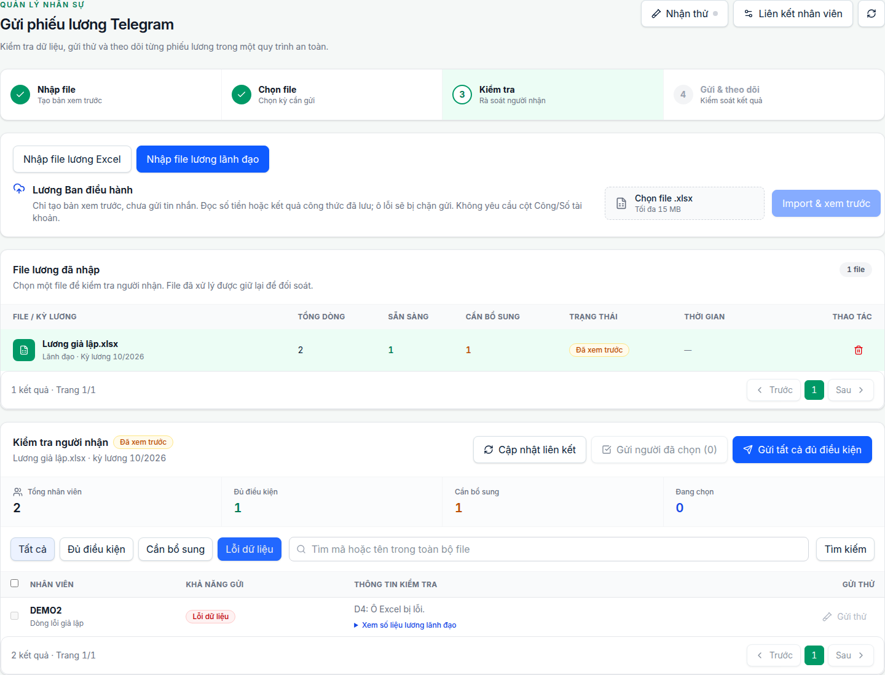
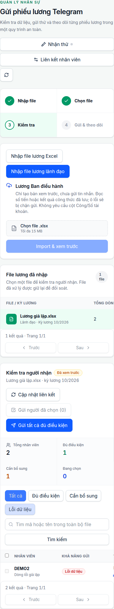

# Nhập file lương lãnh đạo — Ban điều hành

Ngày25/11/2026. Triển khai và kiểm thử trên dev; không import vào production hoặc gửi Telegram thật trong lần này. File nguồn thật được Git ignore, không đóng gói vào release hay dùng làm fixture công khai.

## Cách dùng

1. Mở **Gửi phiếu lương Telegram**, chọn **Nhập file lương lãnh đạo** cạnh lựa chọn lương Excel hiện có.
2. Chọn file.xlsx → **Import & xem trước**. File chỉ được đọc và tạo bản xem trước; chưa gửi cho bất kỳ ai.
3. Lịch sử có nhãn **Lãnh đạo**. Chọn file → mở **Xem số liệu lương lãnh đạo** để kiểm tra lương cơ bản, khoản bù, các khoản thu và thực nhận.
4. Dòng lỗi nằm bộ lọc **Lỗi dữ liệu**, không được chọn/gửi thử/chuyển sang READY khi cập nhật liên kết. Sửa dữ liệu trong Excel và nhập lại file đã sửa; không tự sửa số tiền trong hệ thống.
5. Sau khi dữ liệu đúng, dùng cùng luồng nhận thử, chọn người nhận, tạo hàng đợi và bắt đầu gửi hiện có. Gửi chính thức vẫn cần mã nhân viên khớp hồ sơ và Telegram đã xác minh; không tự đăng ký hoặc đổi người nhận cho lãnh đạo.

Mẫu hiện tại có5người, không giới hạn cứng đúng5. Không yêu cầu cột Công hoặc Số tài khoản và không tự bổ sung các giá trị này vào phiếu. Lương thường tiếp tục dùng lựa chọn cũ và parser cũ.

## Các cột nguồn

Dò tiêu đề trong30dòng đầu, nhận các nhãn theo mẫu: STT; M Số; Họ và Tên; Lương cơ bản; 30% bù đầu năm; TổngTiền lương; Tổng thu; Thuế TNCN; BHXH10,5%; Bgiặt; HTKK; Đảng; quỹASXH; quỹHC; ThuĐP; NH chuyển. Khoảng trắng/xuống dòng/dấu không làm lệch nhận diện. Dòng Tổng cộng không thành người nhận. Kỳ lương lấy từ tiêu đề, kiểm tra tháng1–12. Mã bị lặp chặn import, mã/tên thiếu hoặc không đúng dạng được giữ dưới dạng dòng lỗi.

Lưu và hiển thị số tiền theo file. Nhãn30% chỉ nhận diện cột bù: hệ thống **không tự tính30%**, không tự cộng lại lương/khấu trừ, không xác minh giá trị nghiệp vụ thay Kế toán.

## Công thức và dữ liệu lỗi

- Nhận ô số hoặc số đã lưu làm kết quả công thức trong workbook. Không gọi FormulaEvaluator, không đọc hoặc tải file liên kết ngoài.
- Kết quả công thức đã lưu có thể cũ; người nhập phải đối chiếu trước gửi. Để chắc chắn, mở file cùng nguồn liên kết đúng, tính/lưu lại hoặc dán Values thành bản đã kiểm tra.
- Công thức#REF!/#VALUE!, thiếu cached result, số không hợp lệ hoặc thiếu lương cơ bản/khoản bù/tổng lương/tổng thu/NHchuyển → dòng INVALID, ghi địa chỉ ô cần sửa; không đổi thành0.
- Các ô khoản thu tùy chọn để trống được đọc0. Công thức thiếu kết quả trong cột khoản thu vẫn là lỗi, không coi là ô trống hợp lệ.
- Bản xem trước có thể chứa dòng lỗi để kiểm tra; renderer PDF/lời nhắn chặn dữ liệu có validationErrors, bao gồm API gửi thử. Không tự gửi dữ liệu lỗi.

## Kỹ thuật, quyền và tương thích

API upload hiện có thêm `payrollType=STANDARD|LEADERSHIP`, mặc địnhSTANDARD cho client cũ. Luồng đọc/hash nằm ngoài transaction; persistence bean ghi batch và tra nhân sự/Telegram theo tập. SHA256 vẫn chặn cùng file nhập lại. Row payload giữ loại và các khoản tiền riêng; PDF/lời nhắn Ban điều hành không bịa số công/tài khoản. Quyền payroll hiện có không đổi, không mở choHR_STAFF.

V40 thêm `payroll_type VARCHAR(24) NOT NULL DEFAULT 'STANDARD'` vào bảng import. File cũ nhậnSTANDARD, không đổi payload/phiếu gửi/snapshot cũ. Không xóa bảng/cột hoặc sửa migration đã áp dụng. V40 được khai báo tương thích ngược kèm hash trong auto-migrations; sau CI main đạt, deploy-agent hiện hành backup trước kích hoạt. Không chạy migration/deploy thật trong tác vụ dev này.

Giới hạn reader:15MiB file,40MiB tổng giải nén,256zipentries,20sheet,64cột quét/2.000dòng sheet; không macro hoặc workbook có mật khẩu. Không thêm dependency/cache/queue mới. Màn nhập là component riêng, mutation có QueryClient riêng để không yêu cầu màn payroll cũ đã chuyển sang Query.

## Kiểm chứng

- Test nguồn thật ở máy dev chỉ đọc, nhận5dòng/kỳ10/2026; không ghi DB hoặc in số tiền. CI dùng workbook giả sinh trong test, không phụ thuộc file thật.
- Test số/cached formula, lỗi/thiếu cached result, ô thiếu, mã lặp, mẫu sai, tháng sai, số người khác5; PDF một trang có các khoản riêng, không có Công/Số tài khoản.
- Test persistence giữ INVALID khi refresh, mã/người nhận hiện hành, chống hash trùng; H2 upgradeV39→V40 giữ file cũSTANDARD, migration lặp no-op.
- MCP fixture local kiểm tra7nhóm: chọn loại, chặn file trống, nhãn lịch sử, chi tiết tiền, chặn chọn/gửi dòng lỗi, lọc lỗi, mobile390px. API trong fixture được giả lập, không phải testTelegram thật.

Kết quả cuối25/11: full backend473test,0failure/error,58skipped (51testMySQL opt-in chạy riêng đạt;5testcũ và2sourceworkbook chưa bật). Test đọc mẫu lãnh đạo thật đã bật và đạt; không lưu số liệu thật. MySQL QA backup/restore79bảng khớp count/checksum. Bộ52testPython deploy đạt; frontend build đạt, lint0lỗi/10warningcũ; chunkHrPayroll33,12kB (trước32,42kB). MCP7nhóm fixture đạt, không có lỗi JavaScript; chỉ cófavicon404 của trang test. AST graph local được refresh; không tái trích xuất semantic tài liệu/ảnh. Chưa deploy hoặc gửiTelegram thật.

Lượt MySQL cũng phát hiện fixture lịch sử sức khỏe tái tạo workbook ở các thời điểm khác nhau nên hash ZIP có thể khác; test đã được chỉnh dùng cùng dataset cho bundle và batch thủ công. Không đổi hành vi import sức khỏe.
